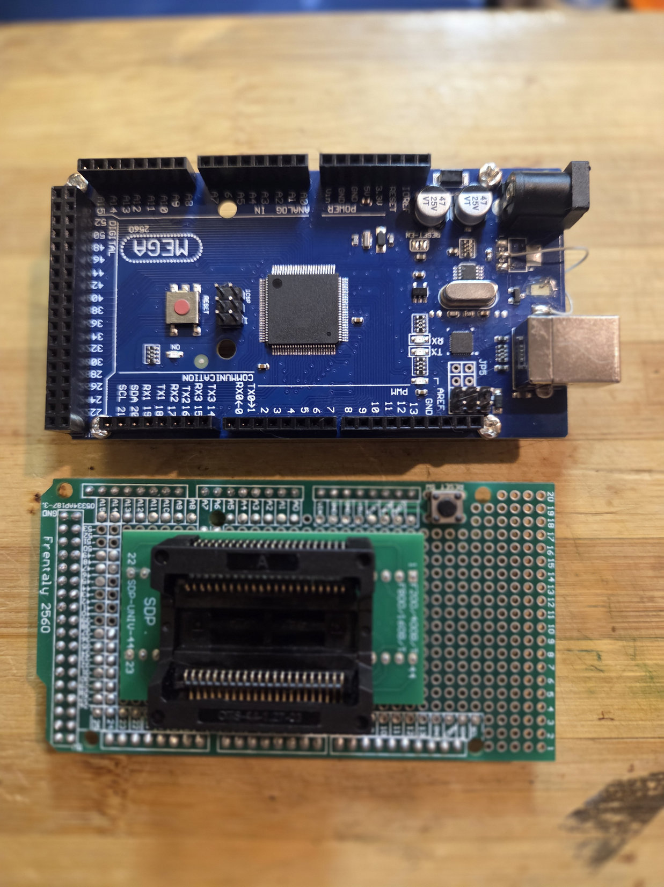
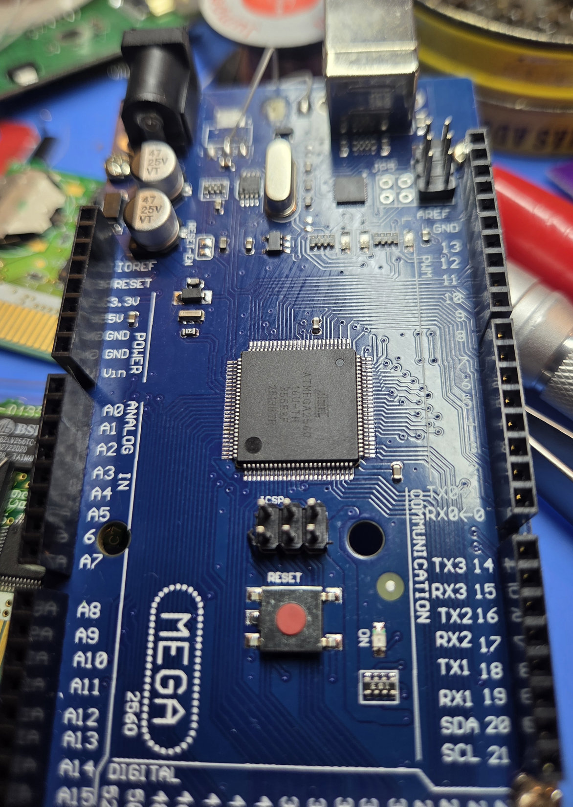
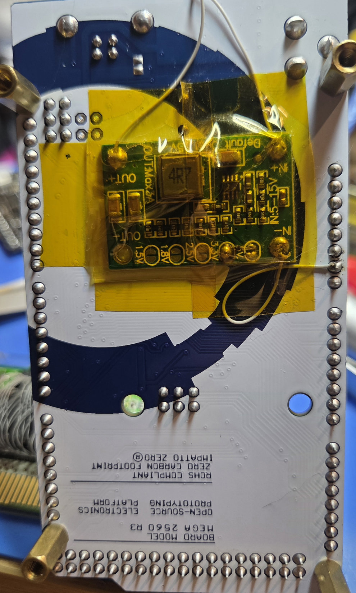
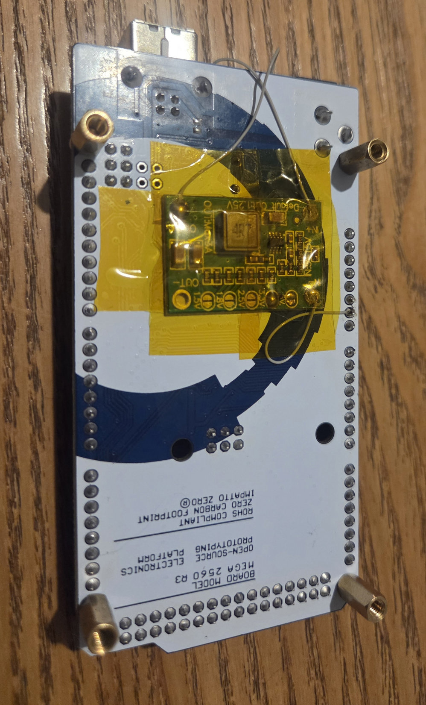
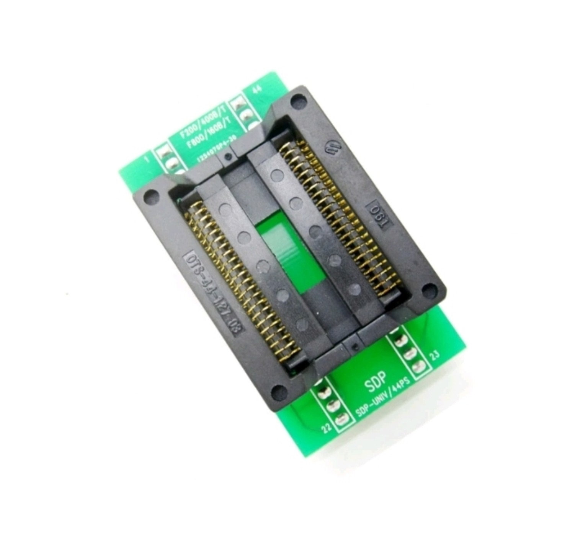
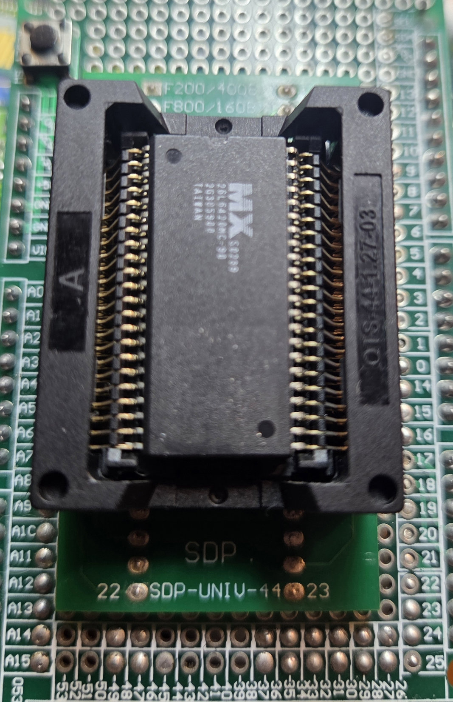
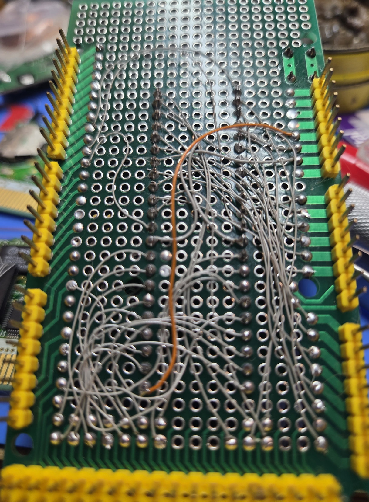
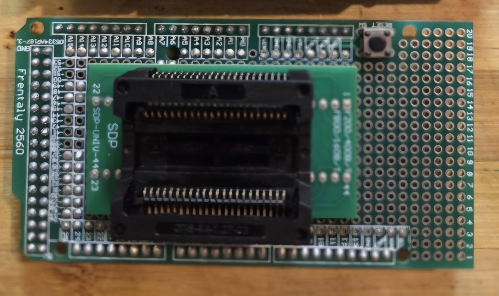
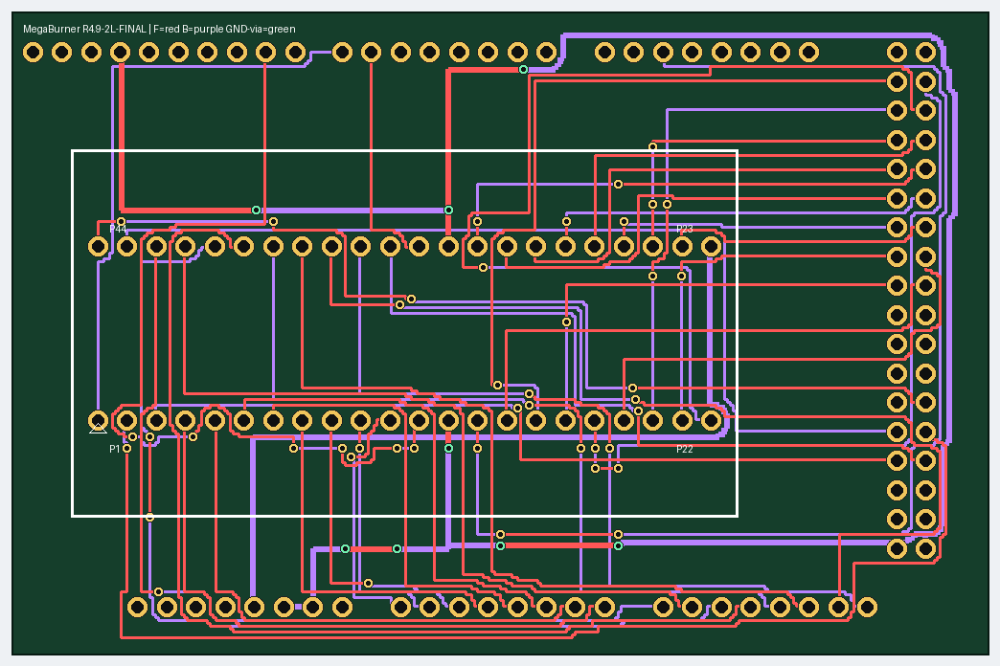
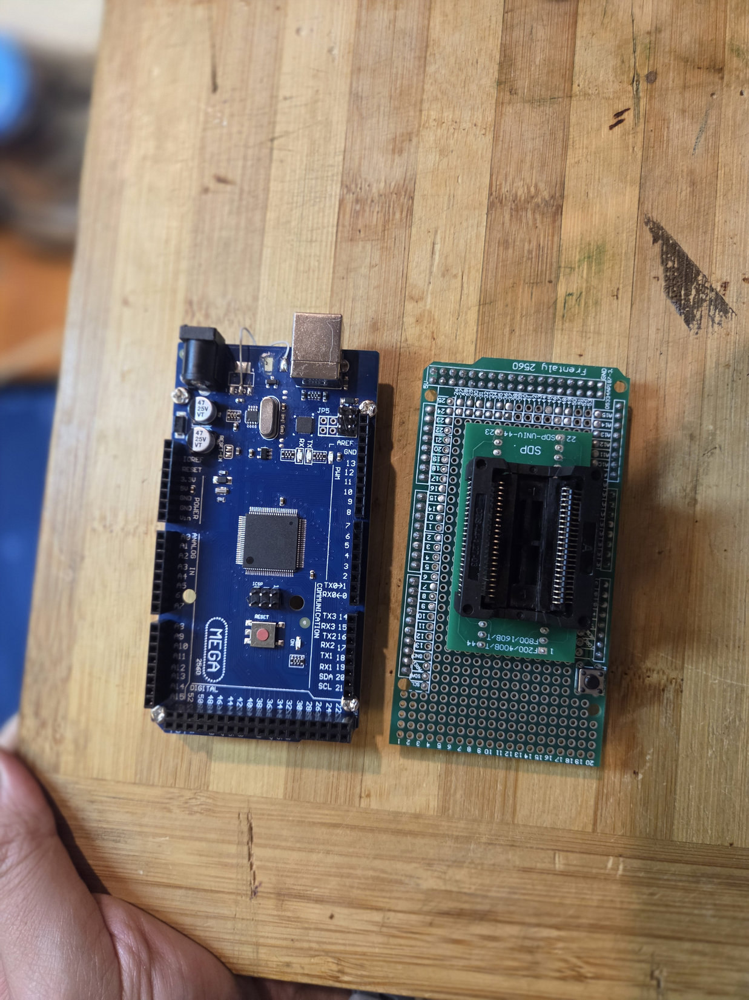

# MegaBurner MultiChip · v0.7A ProfileSafe

**Parallel Flash programmer for Arduino Mega 2560 · Web Serial · SOP44 · R4.9 shield**

**English first · [Español más abajo](#español--manual-completo)**

> [!CAUTION]
> **3.3 V DIRECT-CONNECTION HARDWARE. NEVER install the R4.9 shield on an unmodified 5 V Arduino Mega 2560.** On this particular PCB, the Arduino POWER header contact printed **`5V`** is physically routed to flash socket J1 pin 23. The Mega must be modified so that this contact **actually supplies 3.2–3.4 V**, and all connected I/O must remain in the flash-safe 3.3 V domain. The PCB has **no level shifters, onboard regulator, 5 V protection, or local decoupling capacitors**. Verify with a meter **before fitting any chip**. The firmware cannot prevent electrical damage.
>
> **Images show the earlier hand-wired prototype unless captioned “PCB R4.9”.** PCB preview images are CAD/routing visuals, not proof of a manufactured and tested R4.9 board.

**Project status:** integrated firmware/UI **v0.7A ProfileSafe**, PCB design **R4.9-2L-FINAL**, documentation release **docs.2**. Drivers for MX29L3211 and MX26L6420 inherit physical validation from their respective earlier prototypes. **The new R4.9 shield is not physically validated in this package.** The MX29LV160CTMC-90 driver remains experimental.

**Navigation:** [1. 3.3 V conversion](#1-arduino-mega-2560-33-v-conversion) · [2. Pinout](#2-pinout-and-physical-bus) · [3. INO](#3-how-the-ino-firmware-works) · [4. HTML](#4-how-the-html-application-works) · [5. Each chip](#5-guide-for-each-supported-chip) · [6. Build](#6-building-the-programmer) · [6.5. PCB](#65-purpose-designed-pcb-r49) · [7. Tutorial](#7-end-to-end-tutorial) · [8. Credits](#8-credits-and-provenance) · [9. Additional / AI](#9-additional-information-and-ai-assisted-development).

## 1. Arduino Mega 2560 3.3 V conversion

The normal Mega 2560 is a **5 V logic** board with a **16 MHz** oscillator; the three supported flash memories use a **3.3 V supply**. The R4.9 design deliberately assumes a **whole-board 3.3 V conversion**, not merely powering the flash from the small `3V3` header. The pictured prototype carries an added DC-DC module behind the Mega; a photograph cannot establish its output, wiring correctness, or protection behavior.

### Conceptual conversion and commissioning checklist

1. **Identify the exact Mega board revision and its power circuit** (USB power selector, regulator, USB/serial microcontroller, IOREF, reset and every external peripheral). Record the original wiring; disconnect power and remove all flash devices before any rework.
2. An experienced electronics builder must **modify or replace the regulator/power path** so the entire rail physically marked `5V` and the ATmega2560 logic operate at a regulated 3.3 V. Prevent USB 5 V, barrel-jack input, power-selection circuitry, or a second supply from back-feeding this rail. Merely adding a 3.3 V module to a 5 V Mega is *not* sufficient.
3. Evaluate whether the **USB-to-serial portion remains safe and functional**; a separate device or pull-up may retain 5 V levels even when the main processor runs at 3.3 V. Preserve ground reference, correct protection, insulation and suitable supply current. The historical Adafruit 3.3 V conversion article is **general background**, not a wiring recipe for every Mega clone: [Adafruit conversion guide](https://learn.adafruit.com/arduino-tips-tricks-and-techniques/3-3v-conversion).
4. **16 MHz at 3.3 V is outside the normal guaranteed voltage/frequency range of the standard ATmega2560-16**. Either engineer a compliant clock/voltage variant and adapt the firmware timing/baud assumptions accordingly, or explicitly qualify the out-of-spec build through repeatable temperature, start-up, USB and serial stress tests. Do **not** represent a modified 16 MHz Mega as manufacturer-certified.
5. With **no shield or memory**, measure at the Mega: POWER/`5V` = **3.2–3.4 V**, IOREF approximately 3.3 V, MCU VCC approximately 3.3 V, and *no flash-connected GPIO above the device's allowed voltage*. Test both USB and intended external power paths independently; verify there is no 5 V backfeed.
6. With the **empty R4.9 shield** installed, verify **J1.23 = 3.2–3.4 V** relative to **J1.13 or J1.32 GND**, including under representative load; confirm that the Mega's separate POWER/`3V3` pin is **not** connected to this shield. Check ripple, current headroom and effective local decoupling in the complete assembly.
7. Stop if **any measurement is incorrect**. Never insert a flash while powered. This is a bench engineering project, not a plug-and-play shield for stock Arduino boards.

**Reference:** [Official Arduino Mega 2560 board](https://docs.arduino.cc/hardware/mega-2560/), [Microchip ATmega2560](https://www.microchip.com/en-us/product/ATmega2560), [R4.9 electrical checklist](docs/PCB_R49_WIRING_AND_POWER.md).

## 2. Pinout and physical bus

The electrical source of truth is the **R4.9 KiCad board and its netlist CSV**; the v0.5A historical pinout is *obsolete and unsafe*. The flash is installed through an SA638-B006 / SDP-UNIV-44PS SOP44 adapter into the 44-position J1 footprint. The **adapter's actual internal DIP-to-SOP mapping must be continuity-tested** before use.

- **Address:** A0–A7 = Arduino A0–A7 / `PORTF`, A8–A15 = Arduino A8–A15 / `PORTK`, A16–A20 = D49–D45 / `PORTL` (for profiles using A20 there).
- **Data:** Q0–Q7 = D37–D30 / `PORTC`, Q8–Q15 = D22–D29 / `PORTA`; this is a bidirectional 16-bit data bus.
- **Controls:** CE# = D9/PH6, OE# = D16/PH1. The functions of **physical SOP44 pins 1, 33 and 44 change by chip**, and firmware handles these *only after the user selects the correct profile*.
- **Power:** SOP44/J1 **13 = GND, 23 = VCC (regulated 3.3 V), 32 = GND**. SOP44/J1 **38 = A12, not VCC**. These correct the hazardous old documentation.

| SOP44 pin | Mega | MX29L3211 | MX26L6420MC-90 | MX29LV160CTMC-90 |
|---:|---|---|---|---|
| **1** | D7 / PH4 | WE# | A21 | RESET# |
| **33** | D6 / PH3 | BYTE# | WE# | BYTE# |
| **44** | D45 / PL4 | A20 | A20 | WE# |

<strong>Full J1 pinout — all 44 contacts (click to expand)</strong>

| J1 | Mega | Puerto AVR | Red PCB | MX26L6420 | MX29L3211 | MX29LV160CTMC |
|---:|---|---|---|---|---|---|
| 1 | D7 | PH4 | A21 | A21 | WE# | RESET# |
| 2 | D47 | PL2 | A18 | A18 | A18 | A18 |
| 3 | D48 | PL1 | A17 | A17 | A17 | A17 |
| 4 | A7 | PF7 | A7 | A7 | A7 | A7 |
| 5 | A6 | PF6 | A6 | A6 | A6 | A6 |
| 6 | A5 | PF5 | A5 | A5 | A5 | A5 |
| 7 | A4 | PF4 | A4 | A4 | A4 | A4 |
| 8 | A3 | PF3 | A3 | A3 | A3 | A3 |
| 9 | A2 | PF2 | A2 | A2 | A2 | A2 |
| 10 | A1 | PF1 | A1 | A1 | A1 | A1 |
| 11 | A0 | PF0 | A0 | A0 | A0 | A0 |
| 12 | D9 | PH6 | CE | CE# | CE# | CE# |
| 13 | GND | — | GND | GND | GND | GND |
| 14 | D16 | PH1 | OE | OE# | OE# | OE# |
| 15 | D37 | PC0 | Q0 | Q0 | Q0 | Q0 |
| 16 | D22 | PA0 | Q8 | Q8 | Q8 | Q8 |
| 17 | D36 | PC1 | Q1 | Q1 | Q1 | Q1 |
| 18 | D23 | PA1 | Q9 | Q9 | Q9 | Q9 |
| 19 | D35 | PC2 | Q2 | Q2 | Q2 | Q2 |
| 20 | D24 | PA2 | Q10 | Q10 | Q10 | Q10 |
| 21 | D34 | PC3 | Q3 | Q3 | Q3 | Q3 |
| 22 | D25 | PA3 | Q11 | Q11 | Q11 | Q11 |
| 23 | 5V | — | +3V3 | VCC | VCC | VCC |
| 24 | D33 | PC4 | Q4 | Q4 | Q4 | Q4 |
| 25 | D26 | PA4 | Q12 | Q12 | Q12 | Q12 |
| 26 | D32 | PC5 | Q5 | Q5 | Q5 | Q5 |
| 27 | D27 | PA5 | Q13 | Q13 | Q13 | Q13 |
| 28 | D31 | PC6 | Q6 | Q6 | Q6 | Q6 |
| 29 | D28 | PA6 | Q14 | Q14 | Q14 | Q14 |
| 30 | D30 | PC7 | Q7 | Q7 | Q7 | Q7 |
| 31 | D29 | PA7 | Q15 | Q15 | Q15 | Q15 |
| 32 | GND | — | GND | GND | GND | GND |
| 33 | D6 | PH3 | WE | WE# | BYTE# | BYTE# |
| 34 | D49 | PL0 | A16 | A16 | A16 | A16 |
| 35 | A15 | PK7 | A15 | A15 | A15 | A15 |
| 36 | A14 | PK6 | A14 | A14 | A14 | A14 |
| 37 | A13 | PK5 | A13 | A13 | A13 | A13 |
| 38 | A12 | PK4 | A12 | A12 | A12 | A12 |
| 39 | A11 | PK3 | A11 | A11 | A11 | A11 |
| 40 | A10 | PK2 | A10 | A10 | A10 | A10 |
| 41 | A9 | PK1 | A9 | A9 | A9 | A9 |
| 42 | A8 | PK0 | A8 | A8 | A8 | A8 |
| 43 | D46 | PL3 | A19 | A19 | A19 | A19 |
| 44 | D45 | PL4 | A20 | A20 | A20 | WE# |

**Adapter orientation (shield seen from above, Mega USB connectors on the left):** J1 pin **1 lower-left**, **22 lower-right**, **23 upper-right**, **44 upper-left**. The adapter's package pin-1 mark must also match its own datasheet and socket footprint; never infer an electrical mapping from the case shape alone. Read the [R4.9 44-pin wiring guide](docs/PCB_R49_WIRING_AND_POWER.md) and [netlist CSV](hardware/pcb/R4.9-2L-FINAL/docs/NETLIST_AND_PINOUT.csv).

## 3. How the `.ino` firmware works

**Entry point:** [`MegaBurner_MultiChip_v0_7A_ProfileSafe.ino`](firmware/MegaBurner_MultiChip_v0_7A_ProfileSafe/MegaBurner_MultiChip_v0_7A_ProfileSafe.ino). Keep every `.h` and `.cpp` in the same Arduino sketch folder; the firmware uses direct AVR port operations and is **not** generic for other Arduino families.

1. On boot, `setup()` starts the serial link at **500000 baud** and calls `universalSafePins()`: the candidate CE#/OE#/WE# controls are held inactive, and the data bus is placed in input mode. **This is a software safeguard, not 5 V isolation.**
2. `loop()` parses newline-terminated ASCII commands. The firmware starts at **PROFILE_NONE**. The browser selects exactly one profile with a chip-specific key: `P1,3211`, `P2,6420` or `P3,160C`.
3. **`C` / Check ID** reads the memory's JEDEC manufacturer/device IDs, compares them to the selected profile and sets the `IDOK` interlock. Once successful, the profile is **locked** until reset/reconnect; it cannot be changed mid-session.
4. All read, erase and CRC operations require a verified ID. **Erase (`E`)** is destructive; the firmware latches `ERASEOK` only on successful completion. **Write session (`S`)** is allowed only after a successful erase in the same firmware session.
5. **`W`** sends a safe write block; **`X`** sends a fast write block (not allowed for MX29LV160CT). Each write uses an in-RAM buffer of **4096 bytes maximum** and a device-specific implementation. **`Z`** ends the session and clears erase authorization.
6. **`Roffset,size`** streams raw flash bytes; **`Koffset,size`** emits an eight-character CRC32. The native drivers manage page- or word-programming, addressing, data direction, polling, error detail and reset.

| Serial command | Meaning / key restriction |
|---|---|
| `V`, `Q` | Version / active profile and flags |
| `P1,3211`, `P2,6420`, `P3,160C` | Select *physical* memory profile (must precede ID) |
| `C` | Verify exact JEDEC IDs and lock profile on success |
| `E` | Full-chip erase after ID OK |
| `S`, `Z` | Begin / end write session (erase first) |
| `Woffset,page,size` / `Xoffset,page,size` | Safe / fast write of a binary block (≤4096 bytes) |
| `Roffset,size` / `Koffset,size` | Raw dump / CRC32 |

Write/erase use `&` as ready acknowledgment and `%` as success; `!` begins an error with a code. **No auto-detection, no hot-swap, no guaranteed recovery of an interrupted erase.** Full grammar: [`docs/PROTOCOL.md`](docs/PROTOCOL.md); [driver details](docs/CHIP_COMPATIBILITY.md).

## 4. How the HTML application works

The **actual UI** is [`index.html`](index.html) (mirrored at [`web/index.html`](web/index.html)). It is a local, self-contained HTML + JavaScript application using the browser's **Web Serial API**: no Java GUI, remote server or cloud login is required to run the page. Use a desktop browser that exposes `navigator.serial`, such as a supported Chrome/Edge build. Web Serial needs a **secure context**; local `file://` may work on supported browsers, or host the project locally with `python3 -m http.server 8000` and open `http://localhost:8000/index.html`. Do not host the UI on arbitrary insecure HTTP. [Web Serial compatibility](https://developer.mozilla.org/en-US/docs/Web/API/Web_Serial_API).

The application provides these panels:

- **Safe chip selection:** exact model selector, pin-function summary and physical-confirmation checkbox. Connect applies the selected `P...` key to the firmware and reports its version.
- **Connection & Check ID:** choose the operating system's USB serial port, connect at **500000 baud**, then press **Check ID** before any read/erase/write.
- **Input file preparation:** load a `.bin`/ROM image; **exact size** by default, or explicitly pad with `FF` or repeat/mirror smaller contents. Inspect/download the **prepared image**, since filling and mirroring change its bytes.
- **Operations:** **Erase → Write → CRC quick check → Read/Dump → Compare**. A pre-erase **Read/Dump** is recommended for backup. Compare is a full byte-by-byte comparison; CRC alone is a useful fast check, not a substitute for preserving a backup.
- **Advanced:** read blocks 4–32 KiB (**16 KiB recommended; 32 KiB experimental**), write blocks 1–4 KiB (**4 KiB typical**), chip-specific page size (256/128 for MX29L3211; 2-byte word for the others), Safe/Fast modes where supported, and optional skip-`FF` blocks **only after erase**.
- **Evidence:** progress indicator, event log, downloadable TXT/CSV metrics, and downloads of both prepared image and flash dump. **Stop** is cooperative (between transfer blocks), not an emergency electrical cutoff or guaranteed way to interrupt chip erase.

**Important:** the historical original MegaBurner Java/SWT interface screenshots are **not** screenshots of v0.7A. Do not use them to locate buttons in the current HTML interface.

## 5. Guide for each supported chip

| Parameter | MX29L3211 | MX26L6420MC-90 | MX29LV160CTMC-90 |
|---|---|---|---|
| Nominal flash size | **4 MiB** (4,194,304 bytes) | **8 MiB** (8,388,608 bytes) | **2 MiB** (2,097,152 bytes) |
| Profile selection | `P1,3211` | `P2,6420` | `P3,160C` |
| Expected JEDEC MFR/DEV | `00C2/00F9` | `00C2/22FC` | `00C2/22C4` |
| Programming | **256-byte page** (or 128) | **x16 word**, 2 bytes | **x16 word**, 2 bytes |
| FastWrite | Supported | Supported | **Disabled; SafeWrite only** |
| Physical status | Earlier prototype verified | Earlier prototype verified with two ICs | **Experimental; no physical validation** |

### 5.1 MX29L3211 (4 MiB)

Power off; insert the exact MX29L3211 part at pin 1. Select **MX29L3211**, confirm physically, connect and require ID `00C2/00F9`. Read and save the original 4 MiB dump if needed. Prepare a **4,194,304-byte** image, preferably exact size; page-program defaults to **256 bytes** (128 is an alternative); **Fast** or **Safe** is available. Erase the entire chip, write, check CRC32, then read/dump and compare every byte. This driver descends from the `MX29L3211_v0_5A` baseline, *not* from the 64 Mbit word-program driver.

### 5.2 MX26L6420MC-90 (8 MiB)

Check the package marking *and* that the socket maps **pin 1 = A21, pin 33 = WE#, pin 44 = A20**. Select **MX26L6420MC-90** and require ID `00C2/22FC`. Preserve an **8,388,608-byte** backup. Prepare an 8 MiB image. The **page-size parameter must be 2 bytes** because this chip uses **16-bit word programming**, not 256-byte page programming; serial write blocks can still be 4096 bytes. **FastWrite** is available on the inherited tested route. Erase, write, CRC, dump and compare; do not assume a 4 MiB binary should be duplicated unless that is specifically the intended memory mapping.

### 5.3 MX29LV160CTMC-90 (2 MiB) — experimental

Physically verify the **Top Boot `CT`** variant and **pin 1 = RESET#, pin 33 = BYTE#, pin 44 = WE#**, as the mapping changes substantially. Select **MX29LV160CTMC-90** and require `00C2/22C4`. Image is **2,097,152 bytes**; programming uses **2-byte x16 words**; **SafeWrite only**. Source analysis/datasheet logic exists, but **real Check ID, erase, write, CRC and readback on R4.9 remain unverified**. Test with a disposable chip and noncritical content before relying on this mode; do not use it for irreplaceable data. See [experimental validation limits](docs/MX29LV160CT_VALIDATION.md).

**All three chips:** select the correct model *before* connecting; never pull or swap a powered memory; never force a write after a mismatch or timeout. A PCB wiring check is necessary even if JEDEC ID succeeds.

## 6. Building the programmer

### Parts and tools

- An **Arduino Mega 2560** with a properly engineered and verified 3.3 V conversion (stock 5 V Mega **not permitted** with R4.9).
- **R4.9 two-layer shield PCB** or a carefully verified point-to-point equivalent, 86-position Mega R3 stacking header set, **SA638-B006 / SDP-UNIV-44PS adapter**, appropriate SOP44 socket/clamp and compatible memory chip.
- Quality soldering tools and flux, insulated support for the clamp, continuity/voltage meter, suitable load/test equipment, computer and USB data cable. Follow ESD handling practices.
- Printed [BOM](hardware/pcb/R4.9-2L-FINAL/fabrication/BOM.csv), [first-power checklist](hardware/pcb/R4.9-2L-FINAL/docs/ASSEMBLY_AND_FIRST_POWER.md), [KiCad source](hardware/pcb/R4.9-2L-FINAL/kicad/MegaBurner_MX26L6420_SA638_Shield.kicad_pcb).

### Assembly, in order

1. **Do not start with a flash chip installed.** Review all three chip datasheets and the correct physical layout; study the new R4.9 docs, not legacy v0.5A wiring.
2. Verify the completed **Mega 3.3 V conversion** on its own. Confirm USB and power paths cannot drive 5 V into the chip. Measure the POWER/`5V` rail, IOREF and selected GPIO.
3. Inspect bare R4.9 board for manufacturing defects; verify J1.13/J1.32 GND, J1.23 regulated 3.3 V path, no short to adjacent signals, correct inter-header clearance, and all the intended netlist routes.
4. Fit the complete Mega R3 header set and **SA638 adapter** with the pin-1 orientation shown in the PCB documentation. There are **no mounting eyelets**; use a flat insulating support so opening the clamp does not bend the Mega headers.
5. With all power removed and **no memory fitted**, continuity-test *every* J1-to-SOP contact (all **44**), including Q12/J1.25, and verify absence of shorts. Off-the-shelf socket adapters are not guaranteed to follow arbitrary DIP-to-SOP pin numbers.
6. Power the modified Mega **with the empty shield**. Confirm 3.2–3.4 V at J1.23 under representative load and check the data/control lines. Because R4.9 has **no onboard decouplers**, verify the complete assembly's local bypass performance against the memory datasheet before flashing a chip.
7. Power off, mount the selected flash correctly, connect USB, upload the sketch if needed, then run `Check ID` in the UI. Only proceed after exact-match verification.
8. Perform a **non-destructive dump/backup first**. Re-check image format and proceed to destructive work only when the backup has been saved and independently inspected.

## 6.5. Purpose-designed PCB R4.9

**PCB revision:** `R4.9-2L-FINAL`, 85 × 56 mm, **2-layer FR-4**, default fabrication description **1.6 mm board / 1 oz Cu**, designed as a compact direct-connect shield for the Mega 2560 and the 44-pin adapter. It intentionally includes **no regulator, level translators, input protection, power plug, C1/C2 capacitors, or mounting holes**.

- **Power routing:** J1.23 is connected to the *Mega contact labelled `5V`* that must be converted to **3.3 V**. The Mega contact labelled **`3V3` is not wired** to the R4.9 shield. J1.13 and J1.32 go to GND.
- **Controls:** permanent electrical routes D7→J1.1, D6→J1.33, D45→J1.44; the logical chip functions are selected in firmware. Labels such as `A21/WE/A20` on copper come from the MX26L6420 reference profile, **not** universal pin functions.
- **Mechanical:** SA638 adapter mounts horizontally; the clamp requires support from below. Inspect the actual bought adapter's dimensions, orientation, and 44-contact correspondence before soldering.
- **Manufacturing:** native `.kicad_pcb` and `.kicad_pro` project, Gerber set and Excellon drill, BOM/CPL, layout graphics, netlist CSV and original audit results are included in the [`hardware/pcb/R4.9-2L-FINAL/`](hardware/pcb/R4.9-2L-FINAL/README.md) folder. **PCB-only source**: no native `.kicad_sch`, so a schematic ERC cannot be claimed.
- **Evidence boundary:** file-integrity/static CAD checks and prior driver tests do **not** replace continuity testing, production QA or real read/write measurements on an assembled R4.9.

Do not order or power a board before inspecting the [Gerber/assembly notes](hardware/pcb/R4.9-2L-FINAL/fabrication/FABRICATION_NOTES.md) and [safety checklist](docs/PCB_R49_WIRING_AND_POWER.md).

## 7. End-to-end tutorial

**Phase A — before plugging in:** confirm the Mega is physically converted to 3.3 V; shield and 44 socket contacts passed continuity and voltage checks; identify the exact chip and pin 1; remove power, mount it, reconnect USB. Upload the **current v0.7A `.ino` with all accompanying files** via Arduino IDE using board **Arduino Mega or Mega 2560** and the correct port. The historical `baselines/` sketches are *not* the integrated firmware.

**Phase B — non-destructive backup:**

1. In supported Chrome/Edge, open local [`index.html`](index.html). If local-file Web Serial is unavailable, run `python3 -m http.server 8000` from the project root and open `http://localhost:8000/index.html`.
2. Select the exact chip; tick the physical confirmation; press **Connect and apply profile**; choose its USB serial port. The fixed baud rate is **500000**.
3. Press **Firmware V** if desired, then **Check ID**; require `OK=1` and exact MFR/DEV from the table. If not, stop, disconnect and power down before touching hardware.
4. Press **Read/Dump** *before erase*, then **Download dump**. Save at least one immutable backup and note the full file size and checksum; ideally repeat the dump and compare hashes.

**Phase C — intentional programming:**

5. Load the intended source image. Choose **exact size** (strongly preferred); select FF padding or repeat/mirror *only when justified by the target layout*. Press **Prepare image** and optionally **Download prepared**; inspect its exact length and SHA-256 separately.
6. Verify no protected or irreplaceable data remains. Press **Erase** and await explicit success. **Erase destroys the prior contents.** Do not unplug or stop midway.
7. Set correct page/word mode (automatically constrained by the selected profile), select Safe/Fast only if available, and press **Write**; writing requires a successful erase in the same active firmware session. Do not hot-swap or interrupt power.
8. Press **CRC quick check**. Require equality with the prepared image; then **Read/Dump → Compare** and require **zero differing bytes**. Download post-write dump, TXT log and CSV benchmark evidence.
9. Disconnect; fully remove power before opening the socket. If CRC/dump disagrees, stop and investigate; do not declare success or repeatedly write without inspecting the error and re-establishing a valid erase session.

**Common troubleshooting:** wrong ID → pin 1/33/44 profile, continuity, powered-off orientation, 3.3 V rail; no serial port → close Arduino IDE Serial Monitor, use Web Serial-capable browser; timeout → cable, driver, out-of-spec clock/USB converter, supply stability; unexpected `!I` → missing Check ID, erase or write-session authorization. More: [diagnostics](docs/TROUBLESHOOTING_R49.md) · [tests](docs/TEST_REPORT.md).

## 8. Credits and provenance

- **Original MegaBurner:** [maximaas/MegaBurner](https://github.com/maximaas/MegaBurner) — foundational flash-programming work and original desktop app (historical Java/SWT, *not* the present Web Serial page).
- **Related open hardware/software references:** [sanni/cartreader](https://github.com/sanni/cartreader) (Open Source Cartridge Reader), [mkeller0815/MEEPROMMER](https://github.com/mkeller0815/MEEPROMMER). They are acknowledged as technical precedents, not asserted as dependencies without source evidence.
- **Memory device information:** Macronix data sheets for MX29L3211, MX26L6420 and MX29LV160C; Arduino and Microchip technical publications for Mega 2560 and ATmega2560; [Adafruit](https://learn.adafruit.com/arduino-tips-tricks-and-techniques/3-3v-conversion) for general conversion background.
- **MegaBurner v0.7A contributors and source lineage:** `baselines/MX29L3211_v0_5A`, `baselines/MX26L6420_v0_1`, existing firmware/UI/test suite, R4.9 KiCad/Gerber authoring and provided project documentation; see [full provenance](docs/CREDITS_AND_LINEAGE.md), [lineage](docs/BASELINE_LINEAGE.md) and the unchanged [LICENSE](LICENSE).
- **Photo gallery:** the provided project/prototype photographs and PCB preview, with file-by-file image-source names and SHA-256 records in [gallery manifest](docs/GALLERY_MANIFEST.json). **Commercial product images are visual identification references only**; review rights before public redistribution. No photo implies a physical R4.9 build was tested.

## 9. Additional information and AI-assisted development

This multi-profile programmer was refined through **human-directed development and AI-assisted analysis, documentation, code review, testing and localization** (including OpenAI ChatGPT / GPT). AI helped organize chip profiles, review pinouts and electrical warnings, document the firmware and GUI, and produce repeatable static checks. **AI-generated conclusions are not proof of a safe PCB, hardware measurements, successful flashing, or manufacturer approval.** The definitive evidence is the actual source code, datasheets, board files, reproducible test logs and physical measurements. Human review is required before fabrication or destructive use.

**Verification tiers:**

| Tier | Status in this package |
|---|---|
| Source/asset integrity and documentation consistency | Checked when this release was assembled; see release record |
| Host-side C++/logic/UI and PCB CSV mapping tests | Run when tooling is available; see test output, not a hardware certificate |
| Native AVR compile / Arduino IDE upload | **Not demonstrated in this environment** |
| Real R4.9 assembled shield, voltage/thermal checks, three-chip functional burn | **Pending physical lab testing** |
| MX29LV160CT physical erase/write/dump validation | **Pending** |

**Repository map:** `firmware/` current Arduino source · `index.html` current GUI · `web/` GUI mirror · `config/chips.json` machine-readable profile reference · `tests/` host tests · `docs/` manuals, protocol, history and gallery provenance · `hardware/pcb/R4.9-2L-FINAL/` editable PCB and fabrication files · `baselines/` historic code (reference only) · `assets/gallery/` embedded images. **To publish with GitHub Desktop:** copy the contents of this release's repository folder into the existing local repository (preserve `.git`), inspect the diff, commit locally, then choose *Push origin*. Do not upload a ZIP as a replacement for an existing Git repository.

---

# MegaBurner MultiChip · Manual completo en español

**Programador de memorias Flash paralelas para Arduino Mega 2560 · Web Serial · SOP44 · PCB R4.9**

> [!CAUTION]
> **NO instalar el PCB R4.9 en un Arduino Mega 2560 original de 5 V.** En esta placa, el conector POWER del Arduino rotulado **`5V`** alimenta directamente el pin **J1.23** de la memoria. El Arduino debe estar **modificado integralmente a 3,3 V**, con ese contacto midiendo **3,2–3,4 V**, y todas sus señales de E/S deben respetar los niveles de la memoria. El PCB carece de regulador, conversión de nivel, protección de 5 V y condensadores de desacoplo. **Comprobarlo con multímetro antes de insertar cualquier chip.** El firmware no corrige una alimentación peligrosa.
>
> Las **fotografías muestran el prototipo artesanal anterior**; las imágenes del **PCB R4.9 son vistas de diseño**, no fotografías de una placa fabricada y funcional.

**Alcance:** firmware y HTML **v0.7A ProfileSafe**, PCB **R4.9-2L-FINAL** y revisión documental **docs.2**. MX29L3211 y MX26L6420 conservan antecedentes de ensayos físicos con prototipos anteriores; eso **no valida físicamente el shield R4.9**. El MX29LV160CTMC-90 continúa en fase experimental.

**Contenido:** [1. Modificación 3,3 V](#1-modificación-del-arduino-mega-2560-a-33-v) · [2. Pinout](#2-explicación-del-pinout-y-bus-físico) · [3. INO](#3-funcionamiento-del-firmware-ino) · [4. HTML](#4-funcionamiento-de-la-aplicación-html) · [5. Chips](#5-guía-para-cada-chip) · [6. Construcción](#6-guía-de-construcción) · [6.5. PCB](#65-pcb-r49-diseñada-para-megaburner) · [7. Tutorial](#7-tutorial-general-de-uso) · [8. Créditos](#8-créditos-y-procedencia) · [9. Información adicional e IA](#9-información-adicional-y-desarrollo-asistido-por-ia).

## 1. Modificación del Arduino Mega 2560 a 3,3 V

Un Mega 2560 estándar trabaja con **lógica de 5 V** y oscilador de **16 MHz**. Las tres memorias de este proyecto usan alimentación de **3,3 V**. El PCB R4.9 requiere que **todo el sistema lógico del Mega** funcione a 3,3 V, no solamente conectar la memoria a la pequeña salida `3V3`. El prototipo de las fotos incorpora un convertidor DC-DC en su cara inferior, pero las fotografías **no permiten validar la tensión real ni la seguridad de la modificación**.

### Procedimiento de planificación y verificación eléctrica

1. Identificar **la revisión exacta** del Mega y su circuito de alimentación: regulador, ruta del USB de 5 V, selector automático, interfaz USB-serie, IOREF, RESET y periféricos. Desconectar toda alimentación y retirar las memorias antes de intervenir.
2. Un técnico con experiencia debe **modificar correctamente la ruta de alimentación/regulación** para que la línea física rotulada `5V`, la alimentación del ATmega2560 y las E/S utilizadas operen a **3,3 V**. Hay que impedir la realimentación de 5 V procedente del USB, conector externo, selector automático o una segunda fuente. **Añadir un convertidor de 3,3 V sin aislar la red original de 5 V no es suficiente.**
3. Revisar la **interfaz USB-serie** y todas las resistencias pull-up: pueden seguir introduciendo señales de 5 V aunque la CPU trabaje a 3,3 V. Calcular corriente disponible, aislamiento, protecciones y masa común. La [guía general de Adafruit](https://learn.adafruit.com/arduino-tips-tricks-and-techniques/3-3v-conversion) explica el concepto, pero **no es una receta exacta para cualquier clon Mega**.
4. Tener presente que el **ATmega2560-16 a 16 MHz y 3,3 V queda fuera de su margen normal garantizado de tensión/frecuencia**. Para trabajar dentro de especificaciones se requiere estudiar una variante y reloj compatibles —y ajustar temporización/velocidad serial cuando proceda—; si se conserva 16 MHz habrá que **demostrar estabilidad por ensayos**, sin asumir certificación del fabricante.
5. **Sin shield ni chip**, medir con multímetro el contacto POWER/`5V` (**3,2–3,4 V**), IOREF (~3,3 V), VCC de microcontrolador y las GPIO usadas (sin niveles fuera de tolerancia de la flash). Probar por separado la alimentación USB y la externa, comprobando que no se inyecten 5 V.
6. Con el shield **vacío**, medir **J1.23 = 3,2–3,4 V** respecto a **J1.13/J1.32 = GND**, incluso bajo carga representativa. El contacto POWER/`3V3` del Mega permanece **aislado** en el PCB R4.9. Comprobar margen de corriente, estabilidad y desacoplo real del conjunto.
7. Si algo no coincide, **no montar la memoria ni energizar el circuito con ella instalada**. Es un montaje de ingeniería y requiere validación física independiente.

Más información: [Arduino Mega 2560 oficial](https://docs.arduino.cc/hardware/mega-2560/), [Microchip ATmega2560](https://www.microchip.com/en-us/product/ATmega2560), [comprobaciones R4.9](docs/PCB_R49_WIRING_AND_POWER.md).

## 2. Explicación del pinout y bus físico

La **fuente vigente** del cableado es el proyecto **KiCad R4.9 y su CSV de conexiones**. No se deben utilizar los pinouts v0.5A: existen errores peligrosos en esa documentación anterior. Se usa un adaptador **SOP44 SA638-B006 / SDP-UNIV-44PS** que se suelda al conector de 44 posiciones **J1**; **hay que verificar con continuidad las 44 correspondencias internas del adaptador real**.

- **Direcciones:** A0–A7 = Arduino A0–A7 / `PORTF`; A8–A15 = A8–A15 / `PORTK`; A16–A20 = D49–D45 / `PORTL` para los perfiles que emplean A20.
- **Datos de 16 bits bidireccionales:** Q0–Q7 = D37–D30 / `PORTC`; Q8–Q15 = D22–D29 / `PORTA`.
- **Controles comunes:** CE# = D9/PH6; OE# = D16/PH1. Los pines físicos **1, 33 y 44** cambian de función entre memorias y el firmware los configura **según el perfil seleccionado manualmente**.
- **Alimentación:** SOP44/J1 **13 = GND, 23 = VCC de 3,3 V, 32 = GND**; SOP44/J1 **38 = A12**, **no** es alimentación. Con esto se corrigen inconsistencias críticas del documento antiguo.

| Pin SOP44 | Arduino Mega | MX29L3211 | MX26L6420MC-90 | MX29LV160CTMC-90 |
|---:|---|---|---|---|
| **1** | D7 / PH4 | WE# | A21 | RESET# |
| **33** | D6 / PH3 | BYTE# | WE# | BYTE# |
| **44** | D45 / PL4 | A20 | A20 | WE# |

<strong>Pinout completo de J1: los 44 contactos (desplegar)</strong>

| J1 | Mega | Puerto AVR | Red PCB | MX26L6420 | MX29L3211 | MX29LV160CTMC |
|---:|---|---|---|---|---|---|
| 1 | D7 | PH4 | A21 | A21 | WE# | RESET# |
| 2 | D47 | PL2 | A18 | A18 | A18 | A18 |
| 3 | D48 | PL1 | A17 | A17 | A17 | A17 |
| 4 | A7 | PF7 | A7 | A7 | A7 | A7 |
| 5 | A6 | PF6 | A6 | A6 | A6 | A6 |
| 6 | A5 | PF5 | A5 | A5 | A5 | A5 |
| 7 | A4 | PF4 | A4 | A4 | A4 | A4 |
| 8 | A3 | PF3 | A3 | A3 | A3 | A3 |
| 9 | A2 | PF2 | A2 | A2 | A2 | A2 |
| 10 | A1 | PF1 | A1 | A1 | A1 | A1 |
| 11 | A0 | PF0 | A0 | A0 | A0 | A0 |
| 12 | D9 | PH6 | CE | CE# | CE# | CE# |
| 13 | GND | — | GND | GND | GND | GND |
| 14 | D16 | PH1 | OE | OE# | OE# | OE# |
| 15 | D37 | PC0 | Q0 | Q0 | Q0 | Q0 |
| 16 | D22 | PA0 | Q8 | Q8 | Q8 | Q8 |
| 17 | D36 | PC1 | Q1 | Q1 | Q1 | Q1 |
| 18 | D23 | PA1 | Q9 | Q9 | Q9 | Q9 |
| 19 | D35 | PC2 | Q2 | Q2 | Q2 | Q2 |
| 20 | D24 | PA2 | Q10 | Q10 | Q10 | Q10 |
| 21 | D34 | PC3 | Q3 | Q3 | Q3 | Q3 |
| 22 | D25 | PA3 | Q11 | Q11 | Q11 | Q11 |
| 23 | 5V | — | +3V3 | VCC | VCC | VCC |
| 24 | D33 | PC4 | Q4 | Q4 | Q4 | Q4 |
| 25 | D26 | PA4 | Q12 | Q12 | Q12 | Q12 |
| 26 | D32 | PC5 | Q5 | Q5 | Q5 | Q5 |
| 27 | D27 | PA5 | Q13 | Q13 | Q13 | Q13 |
| 28 | D31 | PC6 | Q6 | Q6 | Q6 | Q6 |
| 29 | D28 | PA6 | Q14 | Q14 | Q14 | Q14 |
| 30 | D30 | PC7 | Q7 | Q7 | Q7 | Q7 |
| 31 | D29 | PA7 | Q15 | Q15 | Q15 | Q15 |
| 32 | GND | — | GND | GND | GND | GND |
| 33 | D6 | PH3 | WE | WE# | BYTE# | BYTE# |
| 34 | D49 | PL0 | A16 | A16 | A16 | A16 |
| 35 | A15 | PK7 | A15 | A15 | A15 | A15 |
| 36 | A14 | PK6 | A14 | A14 | A14 | A14 |
| 37 | A13 | PK5 | A13 | A13 | A13 | A13 |
| 38 | A12 | PK4 | A12 | A12 | A12 | A12 |
| 39 | A11 | PK3 | A11 | A11 | A11 | A11 |
| 40 | A10 | PK2 | A10 | A10 | A10 | A10 |
| 41 | A9 | PK1 | A9 | A9 | A9 | A9 |
| 42 | A8 | PK0 | A8 | A8 | A8 | A8 |
| 43 | D46 | PL3 | A19 | A19 | A19 | A19 |
| 44 | D45 | PL4 | A20 | A20 | A20 | WE# |

**Orientación (vista superior del shield con USB del Mega a la izquierda):** J1 **pin 1 abajo izquierda, 22 abajo derecha, 23 arriba derecha, 44 arriba izquierda**. Hacer coincidir la marca pin 1 del encapsulado con la del zócalo y medir la adaptación DIP–SOP; la forma externa no garantiza la correspondencia eléctrica. Consultar la [guía de conexiones R4.9](docs/PCB_R49_WIRING_AND_POWER.md) y el [CSV original](hardware/pcb/R4.9-2L-FINAL/docs/NETLIST_AND_PINOUT.csv).

## 3. Funcionamiento del firmware `.ino`

La entrada principal es [`MegaBurner_MultiChip_v0_7A_ProfileSafe.ino`](firmware/MegaBurner_MultiChip_v0_7A_ProfileSafe/MegaBurner_MultiChip_v0_7A_ProfileSafe.ino); necesita los archivos `.cpp` y `.h` contiguos. Opera con registros AVR directos y **no está diseñado para otras placas Arduino**.

1. Al arrancar, `setup()` inicia el puerto a **500000 baudios** y `universalSafePins()` desactiva controles posibles de memoria y configura el bus de datos como entrada. Esto **no sustituye aislamiento ni protección eléctrica**.
2. `loop()` procesa comandos ASCII terminados en salto de línea. Inicia **sin perfil**; la web envía `P1,3211`, `P2,6420` o `P3,160C`, con claves distintas para prevenir selecciones accidentales.
3. **`C` / Check ID** lee fabricante y dispositivo JEDEC, valida coincidencia exacta y activa el bloqueo `IDOK`. Con ID correcto el perfil queda **bloqueado hasta reset/reconexión**.
4. Leer, borrar y calcular CRC exige ID correcto. **`E` borra toda la memoria** y habilita `ERASEOK` si termina satisfactoriamente. **`S` inicia escritura** sólo después de un borrado correcto en esa sesión.
5. **`W`** escribe bloques en modo seguro; **`X`** permite modo rápido sólo en los perfiles compatibles. El firmware usa un búfer de **máximo 4096 bytes** y un controlador específico para cada memoria. **`Z`** cierra la sesión y borra la autorización de escritura.
6. **`Roffset,size`** lee datos binarios; **`Koffset,size`** calcula CRC32 y devuelve ocho caracteres hexadecimales. Los drivers gestionan el bus, las páginas/palabras, polling, reinicio y errores.

| Comando | Función y restricciones |
|---|---|
| `V`, `Q` | Versión / perfil activo y bloqueos |
| `P1,3211`, `P2,6420`, `P3,160C` | Seleccionar el chip antes de Check ID |
| `C` | Verificar fabricante/dispositivo y bloquear perfil |
| `E` | Borrado total tras ID correcto |
| `S`, `Z` | Abrir/cerrar sesión de escritura (borrado previo obligatorio) |
| `Woffset,page,size` / `Xoffset,page,size` | Bloque seguro/rápido de datos binarios (≤4096 bytes) |
| `Roffset,size` / `Koffset,size` | Lectura binaria / CRC32 |

`&` indica que el firmware está listo, `%` operación correcta y `!` indica error (seguido de código). **No se autodetecta el chip**, no admite intercambio en caliente ni garantiza recuperación de un borrado interrumpido. Ver [protocolo v0.7A](docs/PROTOCOL.md).

## 4. Funcionamiento de la aplicación HTML

La interfaz actual es [`index.html`](index.html), con copia en [`web/index.html`](web/index.html). Es una aplicación **HTML/JavaScript autónoma** que funciona localmente usando **Web Serial**, sin Java/SWT ni servicio remoto. Requiere navegador de escritorio compatible (por ejemplo Chrome/Edge con `navigator.serial`) y un **contexto seguro**. Se puede probar abriendo `index.html` localmente; si el navegador bloquea Web Serial en `file://`, iniciar `python3 -m http.server 8000` en la carpeta del proyecto y abrir `http://localhost:8000/index.html`. [Referencia Web Serial](https://developer.mozilla.org/en-US/docs/Web/API/Web_Serial_API).

Los módulos de la interfaz son:

- **Selección segura:** elegir exactamente la memoria instalada, ver el resumen de pines y confirmar físicamente mediante casilla; el botón de conexión envía la clave del perfil.
- **Conectar / Check ID:** escoger puerto serial USB, abrir a **500000 baudios**, comprobar versión y validar el identificador JEDEC antes de leer, borrar o escribir.
- **Preparar archivo:** cargar imagen binaria, mantener **tamaño exacto** preferentemente, o aplicar conscientemente relleno `FF` o repetición/espejado; se puede descargar el archivo preparado para inspección.
- **Operaciones:** **Erase → Write → CRC → Read/Dump → Comparar**; para conservar los datos anteriores hacer **Read/Dump antes del borrado**. Comparar verifica byte por byte; CRC rápido no reemplaza un respaldo.
- **Avanzado:** bloques de lectura de 4 a 32 KiB (**16 KiB recomendado; 32 KiB experimental**), escritura de 1 a 4 KiB (**4 KiB habitual**), página 256/128 sólo para MX29L3211 y palabra de 2 bytes para los otros; Safe/Fast dependiendo del chip y salto de bloques `FF` únicamente después de borrado correcto.
- **Registros:** progreso, bitácora, exportación TXT/CSV, descarga de imagen preparada y volcado. **Detener** actúa entre bloques; **no es apagado de emergencia** ni detiene con garantía un borrado iniciado.

La captura histórica de MegaBurner Java/SWT no debe confundirse con la interfaz Web Serial actual.

## 5. Guía para cada chip

| Parámetro | MX29L3211 | MX26L6420MC-90 | MX29LV160CTMC-90 |
|---|---|---|---|
| Capacidad | **4 MiB** (4.194.304 bytes) | **8 MiB** (8.388.608 bytes) | **2 MiB** (2.097.152 bytes) |
| Perfil | `P1,3211` | `P2,6420` | `P3,160C` |
| ID fabricante/dispositivo | `00C2/00F9` | `00C2/22FC` | `00C2/22C4` |
| Método de programación | Página de **256** o **128 bytes** | Palabra x16 de **2 bytes** | Palabra x16 de **2 bytes** |
| FastWrite | Sí | Sí | **No, sólo SafeWrite** |
| Validación física heredada | Prototipo anterior | Prototipo anterior con dos chips | **No; experimental** |

### 5.1 MX29L3211 — 4 MiB

Con alimentación apagada, insertar el chip correctamente. Seleccionar **MX29L3211**, confirmar, conectar y exigir ID `00C2/00F9`. Antes de borrar, guardar un volcado original de **4.194.304 bytes** si tiene datos que conservar. Preparar imagen de tamaño exacto, elegir **página de 256 bytes** por defecto (128 opcional) y modo **Fast o Safe**. Ejecutar borrado total, escritura, CRC32 y lectura/comparación byte a byte. Deriva de `baselines/MX29L3211_v0_5A`; no usa el algoritmo Word Program del chip de 64 Mbit.

### 5.2 MX26L6420MC-90 — 8 MiB

Verificar la referencia física y que el adaptador conecte **pin 1 = A21, 33 = WE#, 44 = A20**. Seleccionar el perfil MX26L6420 y exigir `00C2/22FC`. Guardar un respaldo de **8.388.608 bytes**. Preparar la imagen exacta de 8 MiB; el parámetro de página debe ser **2 bytes**, porque se programa en **palabras x16** aunque la transferencia serial pueda agrupar 4096 bytes. **FastWrite** está disponible en esta ruta heredada. Borrar, escribir, comprobar CRC y comparar el volcado; no duplicar automáticamente un archivo de 4 MiB sin verificar que así lo requiera la aplicación final.

### 5.3 MX29LV160CTMC-90 — 2 MiB (experimental)

Confirmar versión **Top Boot `CT`** y pines **1 = RESET#, 33 = BYTE#, 44 = WE#**. Elegir el perfil correcto y exigir ID `00C2/22C4`; tamaño objetivo **2.097.152 bytes**. Programación en palabras x16 de 2 bytes y **SafeWrite obligatorio**. Existen comprobaciones lógicas y revisión de datasheet, pero **no hay evidencia física de Check ID, borrado, escritura ni dump usando R4.9**. Usar memoria de prueba prescindible, nunca información irremplazable. [Estado de validación](docs/MX29LV160CT_VALIDATION.md).

Para todos los chips: comprobar orientación, alimentación y perfil **antes de conectar**; nunca cambiar la memoria con el sistema alimentado. Si falla el ID, no forzar borrado ni escritura.

## 6. Guía de construcción

### Materiales y herramientas

- **Arduino Mega 2560 modificado y verificado íntegramente a 3,3 V** (el modelo de fábrica de 5 V es incompatible con el shield R4.9).
- **PCB R4.9 de dos capas**, conjunto completo de 86 posiciones de headers Mega R3, adaptador **SA638-B006 / SDP-UNIV-44PS**, zócalo/clamp SOP44 y memoria compatible.
- Estación de soldadura, flux, soporte aislante para la pinza, multímetro para continuidad y voltaje, carga/equipo de prueba, cable de datos USB, PC y protección contra ESD.
- Documentos: [BOM](hardware/pcb/R4.9-2L-FINAL/fabrication/BOM.csv), [montaje y primer encendido](hardware/pcb/R4.9-2L-FINAL/docs/ASSEMBLY_AND_FIRST_POWER.md), [KiCad](hardware/pcb/R4.9-2L-FINAL/kicad/MegaBurner_MX26L6420_SA638_Shield.kicad_pcb).

### Secuencia recomendada

1. **No insertar ninguna memoria.** Consultar los datasheets de cada modelo y el pinout vigente R4.9, no la documentación eléctrica v0.5A.
2. Modificar y verificar **por separado** el Mega a 3,3 V, incluyendo la ruta USB y el pin POWER rotulado `5V`, IOREF y GPIO.
3. Inspeccionar la placa R4.9 sin componentes; comprobar las redes de potencia, GND, aislamiento de contactos cercanos y correspondencia con el CSV.
4. Soldar headers Mega R3 y adaptador SA638 en la **orientación correcta**. El diseño no tiene agujeros de anclaje: apoyar el shield sobre una base aislante plana para evitar que la fuerza de la pinza flexione los headers.
5. Todo **desconectado y sin chip**: comprobar continuidad de **los 44 contactos** J1→SOP, ausencia de cortos y especial atención a J1.25/Q12, sensible en el prototipo anterior.
6. Alimentar el Mega modificado con el shield **vacío**. Medir J1.23 a **3,2–3,4 V** en carga y revisar señales; verificar desacoplo adecuado en el conjunto, dado que R4.9 **no lo incorpora**.
7. Apagar, insertar el chip respetando pin 1, conectar USB, cargar firmware v0.7A y hacer **Check ID**. No realizar operaciones si no coincide exactamente.
8. **Hacer un respaldo antes de cualquier borrado**. Revisar su tamaño y hash, preparar la imagen destino y sólo después ejecutar funciones destructivas.

## 6.5. PCB R4.9 diseñada para MegaBurner

El **PCB `R4.9-2L-FINAL`** es un shield compacto de **85 × 56 mm**, **2 capas**, fabricación de referencia **FR-4 de 1,6 mm y cobre de 1 oz**. Está pensado para alojar horizontalmente el adaptador SOP44 sobre un Mega 2560. Por decisión de diseño **no contiene regulador, conversores de nivel, protección de 5 V, conector adicional de alimentación, C1/C2 ni orificios de fijación**.

- **Alimentación:** J1.23 llega a la posición POWER del Mega que está rotulada `5V` pero **debe medir 3,3 V tras la modificación**. El contacto POWER `3V3` del Mega queda **aislado**; J1.13/J1.32 son GND.
- **Conexiones variables:** D7→J1.1, D6→J1.33 y D45→J1.44 permanecen físicamente fijas. El firmware asigna función según la memoria. Las etiquetas del cobre de A21, WE y A20 representan el perfil de MX26L6420, no todos los chips.
- **Mecánica:** adaptar la altura y orientación del SA638-B006; comprobar compatibilidad real del adaptador adquirido; usar soporte aislante bajo la pinza.
- **Archivos de fabricación:** se incluyen proyecto editable `.kicad_pcb`/`.kicad_pro`, Gerbers, perforaciones Excellon, BOM, CPL, previsualizaciones, CSV y auditorías de diseño en [`hardware/pcb/R4.9-2L-FINAL/`](hardware/pcb/R4.9-2L-FINAL/README.md). **No existe esquemático `.kicad_sch` en el paquete**: no se debe afirmar una validación ERC de esquemático.
- **Estado real:** auditorías estáticas y pruebas anteriores del firmware no reemplazan mediciones de una placa **R4.9 fabricada y ensamblada**. Permanecen pendientes continuidad, alimentación real y programación de memorias sobre este nuevo shield.

Revisar [notas de fabricación](hardware/pcb/R4.9-2L-FINAL/fabrication/FABRICATION_NOTES.md) y [lista de seguridad](docs/PCB_R49_WIRING_AND_POWER.md) antes de fabricar o utilizar la placa.

## 7. Tutorial general de uso

**Etapa A — montaje y firmware:** verificar modificación 3,3 V del Mega, continuidad y tensiones del shield, correspondencia de 44 contactos y orientación pin 1. Insertar la memoria **sólo sin corriente**. Con Arduino IDE seleccionar **Arduino Mega or Mega 2560**, puerto correcto y abrir [`firmware/MegaBurner_MultiChip_v0_7A_ProfileSafe/MegaBurner_MultiChip_v0_7A_ProfileSafe.ino`](firmware/MegaBurner_MultiChip_v0_7A_ProfileSafe/MegaBurner_MultiChip_v0_7A_ProfileSafe.ino) junto con sus `.cpp/.h`. Las carpetas `baselines/` son versiones históricas, no el sketch actual.

**Etapa B — copia de seguridad:**

1. Abrir [`index.html`](index.html) en Chrome/Edge compatible. Si `file://` no permite Web Serial, desde la raíz ejecutar `python3 -m http.server 8000` y visitar `http://localhost:8000/index.html`.
2. Seleccionar el modelo **exactamente igual a la serigrafía del chip**, marcar la casilla de confirmación y pulsar **Conectar y aplicar perfil**; seleccionar el puerto USB. La velocidad fija es **500000 baudios**.
3. Consultar **Firmware V** si es necesario y pulsar **Check ID**. Exigir `OK=1` e ID fabricante/dispositivo correctos. Si no coincide, detener, desconectar y apagar antes de revisar la electrónica.
4. Pulsar **Read/Dump** **antes de Erase**. Guardar el **dump original**, verificar tamaño y SHA-256; idealmente repetir la lectura y contrastar ambos hashes.

**Etapa C — grabación controlada:**

5. Cargar el archivo binario de destino. Preferir **tamaño exacto**; usar relleno `FF` o repetición/espejado únicamente si es intencional. Pulsar **Preparar imagen**, descargarla e inspeccionar tamaño y hash.
6. Confirmar respaldo y necesidad de borrar; ejecutar **Erase** y esperar éxito explícito. **Borrar destruye el contenido anterior**. No desconectar la alimentación durante la operación.
7. Elegir parámetros que permite el perfil (página o palabra, Safe/Fast); pulsar **Write**. El firmware requiere borrado exitoso **en la misma sesión**. No retirar la memoria ni cortar energía.
8. Ejecutar **CRC rápido** y exigir coincidencia con la imagen preparada. Luego **Read/Dump → Comparar**, exigiendo **cero diferencias de bytes**. Exportar volcado, TXT y CSV de métricas.
9. Desconectar y **apagar completamente** antes de abrir el socket. Si falla CRC o comparación, investigar el fallo antes de un nuevo intento; no declarar éxito ni escribir repetidamente sin restablecer un borrado válido.

**Problemas comunes:** ID incorrecto → perfil y funciones 1/33/44, orientación, alimentación, continuidad; sin puerto serial → cerrar Monitor Serial del IDE, comprobar navegador USB; timeout → reloj a 3,3 V fuera de especificación, convertidor USB, alimentación o cable; `!I` → falta ID, borrado o autorización de sesión. [Guía de diagnóstico](docs/TROUBLESHOOTING_R49.md) · [informe de pruebas](docs/TEST_REPORT.md).

## 8. Créditos y procedencia

- **MegaBurner original:** [maximaas/MegaBurner](https://github.com/maximaas/MegaBurner), base histórica del programador y su programa de escritorio Java/SWT (diferente de esta página Web Serial).
- **Antecedentes técnicos:** [sanni/cartreader](https://github.com/sanni/cartreader) (lector de cartuchos de código abierto) y [mkeller0815/MEEPROMMER](https://github.com/mkeller0815/MEEPROMMER). Se reconocen como referencias, sin atribuirles dependencias no demostradas.
- **Documentación técnica:** datasheets Macronix MX29L3211, MX26L6420 y MX29LV160C; materiales oficiales Arduino y Microchip; [Adafruit](https://learn.adafruit.com/arduino-tips-tricks-and-techniques/3-3v-conversion) como referencia conceptual de conversión.
- **Linaje del proyecto MultiChip:** código, pruebas y documentación v0.7A, bases `baselines/MX29L3211_v0_5A` y `baselines/MX26L6420_v0_1`, diseño KiCad R4.9 y materiales aportados; consultar [créditos extendidos](docs/CREDITS_AND_LINEAGE.md), [linaje](docs/BASELINE_LINEAGE.md) y archivo [LICENSE](LICENSE), preservado.
- **Galería:** imágenes suministradas del prototipo y vista del diseño R4.9, identificadas en [manifiesto](docs/GALLERY_MANIFEST.json) con nombre original y SHA-256. Las fotografías comerciales son **referencias visuales**; verificar derechos antes de publicar en GitHub. No demuestran funcionamiento de PCB R4.9.

## 9. Información adicional y desarrollo asistido por IA

Durante el trabajo en MegaBurner se ha utilizado **inteligencia artificial, incluidos ChatGPT y modelos GPT de OpenAI**, como apoyo a la investigación, revisión del código, análisis de conexiones, documentación, pruebas estáticas y organización de perfiles de memoria. La IA puede ayudar a identificar errores y producir procedimientos, **pero no sustituye la evaluación de un profesional, la consulta de datasheets, la compilación AVR ni las pruebas eléctricas reales**. Tampoco implica que el diseño esté aprobado o certificado por OpenAI, Arduino, Microchip o Macronix.

| Nivel de comprobación | Estado de esta entrega |
|---|---|
| Integridad de archivos, imágenes y coherencia documental | Verificada en el ensamblado del paquete; ver registro |
| Pruebas C++ host, lógica, HTML y compatibilidad de CSV con firmware | Ejecutables con herramientas disponibles; consultar resultados |
| Compilación AVR nativa y carga mediante Arduino IDE | **No demostrada en este entorno** |
| Alimentación y grabación reales con un shield R4.9 montado | **Pendientes de pruebas físicas** |
| Validación física MX29LV160CT de borrado/escritura/lectura | **Pendiente** |

**Estructura del repositorio:** `firmware/` sketch y drivers actuales · `index.html` interfaz principal · `web/` copia HTML · `config/chips.json` perfiles · `tests/` pruebas host · `docs/` manuales, historial y procedencia de imágenes · `hardware/pcb/R4.9-2L-FINAL/` fuentes editables y fabricación · `baselines/` histórico · `assets/gallery/` fotografías integradas. **Para actualizar desde GitHub Desktop:** copiar **el contenido interno** de la carpeta de esta entrega sobre el repositorio local conservando `.git`, revisar diferencias, crear commit local y pulsar *Push origin*. No reemplazar el repositorio por un archivo ZIP.
